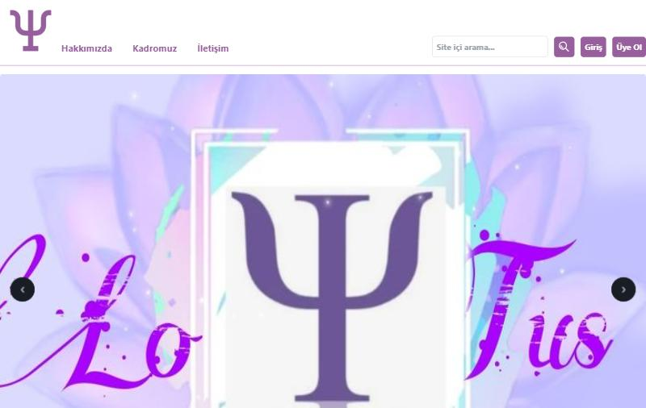

# Lotus Psikiyatri Kliniği — Web Sitesi

Bir psikiyatri kliniği için **Tailwind CSS** ve **DaisyUI** ile kodladığım 7 sayfalık tanıtım sitesi. Web tasarım ve kodlama eğitimim sırasında hazırladığım bir projedir.

🔗 **Canlı demo:** [iremerdoan.github.io/lotus-klinik-sitesi](https://iremerdoan.github.io/lotus-klinik-sitesi/)

## Kullanılan teknolojiler

- **HTML5**
- **Tailwind CSS:** tüm düzen ve stiller yardımcı sınıflarla yazıldı
- **DaisyUI:** ana sayfadaki görsel kaydırıcı (carousel) gibi hazır bileşenler
- **Google Fonts**

## Sayfalar

| Sayfa | İçerik |
| --- | --- |
| `index.html` | Ana sayfa: görsel kaydırıcı, hizmet tanıtımları |
| `hakkimizda.html` | Misyon, vizyon ve değerler |
| `kadromuz.html` | Uzman kadrosu kartları |
| `iletisim.html` | Klinik adresi ve iletişim bilgileri |
| `form.html` | Kişisel bilgiler ve randevu detaylarından oluşan randevu formu |
| `Gorsel.html` | Görsel galeri |
| `adres.html` | Ofis adresi |

## Çalıştırma

Kurulum gerekmez. Depoyu indirip `index.html` dosyasını tarayıcıda açmak yeterli. Tailwind CSS ve DaisyUI internet üzerinden (CDN) yüklenir.

## Not

Bu site eğitim amaçlı hazırlanmıştır. Sitedeki form gerçek bir randevu sistemine bağlı değildir.

## Geliştiren

**İrem Erdoğan** · [GitHub](https://github.com/iremerdoan)
